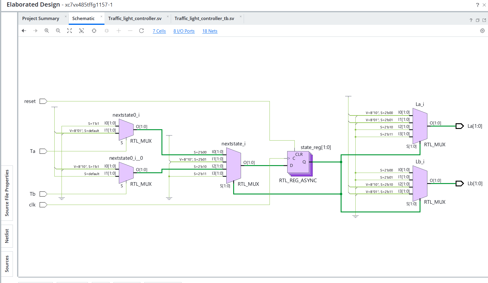
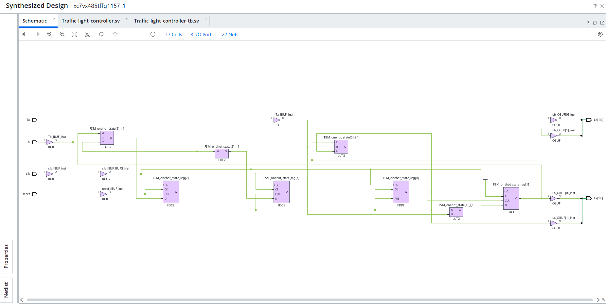

# Traffic_Light_Controller_FSM
Design and simulation of a Moore finite state machine (FSM) traffic light controller using SystemVerilog, with a testbench and state transition diagram.

## Simulation Results

### 1. Vivado Simulation Waveform

### 2. RTL Schematic

### 3. Synthesized Schematic

